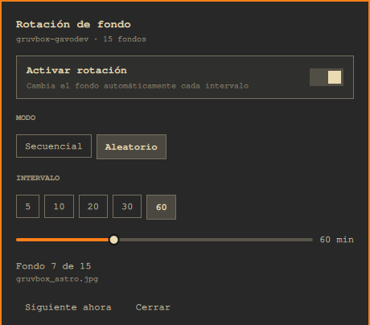

# Background Rotation



*The panel follows Omarchy's language setting; shown here in Spanish.*

A small Omarchy shell plugin that rotates backgrounds for the active theme on a schedule.

## Features

* Rotates the active theme's backgrounds every 1 to 180 minutes.
* Chooses sequentially, with alphabetical wrap, or randomly without repeating the current background.
* Follows theme changes automatically, with no extra setup.
* Offers on demand rotation and a panel for settings and current status.
* Keeps the enabled state, mode, interval, and next scheduled rotation across shell restarts.
* Accepts JPG, JPEG, PNG, GIF, BMP, WebP, MP4, M4V, MOV, WebM, MKV, and AVI backgrounds.

## Requirements

* Omarchy 0.56 or newer. Tested with 0.56.2.
* `jq`, used by the included script for its state JSON.
* `hyprctl` and `omarchy-shell`, both included with Omarchy.

## Install

```sh
omarchy plugin add https://github.com/GaboEI/omarchy-bg-rotate
```

For a manual install, copy this plugin directory to `~/.config/omarchy/plugins/gabodev.bg-rotate/`, then run:

```sh
omarchy-shell shell rescanPlugins
omarchy plugin enable gabodev.bg-rotate
```

## Usage

Open the panel with `SUPER + CTRL + ALT + P`. Change this binding in `~/.config/hypr/bindings.lua` if needed. You can also open it from Omarchy's Appearance menu. Its label depends on your menu configuration.

| Control | What it does |
| --- | --- |
| Enable | Starts or stops scheduled rotation. |
| Sequential / Random | Uses alphabetical order with wrap, or picks a background other than the current one. |
| Interval presets and slider | Sets the interval from 1 to 180 minutes. Presets are 5, 10, 20, 30, and 60 minutes. |
| Rotate now | Changes the background immediately. |
| Status | Shows the theme, background count, current position, and current file name. |
| Close | Closes the panel with Escape or a click outside it. |

## Configuration

The plugin stores its settings in `~/.config/omarchy/bg-rotate/config.json`.

| Key | Meaning |
| --- | --- |
| `enabled` | Whether scheduled rotation is active. |
| `mode` | `next` for sequential rotation or `random` for a nonrepeating pick. |
| `intervalMinutes` | Rotation interval, from 1 to 180 minutes. |
| `nextDueAt` | Next scheduled rotation as epoch milliseconds. It survives shell restarts and is restored when the plugin loads. |

Optional IPC commands:

```sh
omarchy-shell gabodev.bg-rotate status
omarchy-shell gabodev.bg-rotate enable
omarchy-shell gabodev.bg-rotate disable
omarchy-shell gabodev.bg-rotate toggle
omarchy-shell gabodev.bg-rotate mode <next|random>
omarchy-shell gabodev.bg-rotate interval <minutes>
omarchy-shell gabodev.bg-rotate next
```

## How it works

* The service draws nothing and runs the included Bash script to list the active theme's backgrounds and choose the next one.
* The script calls Omarchy's `omarchy-theme-bg-set`, which updates `~/.local/state/omarchy/current/background` and notifies the shell through IPC.
* A QML timer schedules nonblocking processes, prevents overlap, and stops a stalled process after 45 seconds with `SIGTERM`, then five seconds later with `SIGKILL`.
* `FileView` saves the scheduling state.

## Notes and limitations

* The active theme is read for every rotation. After changing themes, rotation continues with the new theme's backgrounds.
* If the active background was removed, the next rotation starts again from the first available background and repairs the dangling state. If no backgrounds exist, the plugin notifies you and does nothing else.
* Add backgrounds to `~/.config/omarchy/backgrounds/<theme-slug>/` for immediate detection. Backgrounds added to `~/.config/omarchy/themes/<theme>/backgrounds/` need `omarchy theme set <theme>` to rebuild Omarchy's state.
* AVIF, SVG, and HEIC files are ignored.
* Omarchy uses one global background path for all screens. This plugin does not support separate backgrounds per monitor. Adding that capability would require replacing Omarchy's native `omarchy.background` plugin.
* There is no thumbnail picker. Use Omarchy's `omarchy theme bg next` command or its background switcher to select a specific background.
* The plugin declares `keepLoaded: true`. After editing its code, run `omarchy restart shell` so the live instance is replaced.

## Uninstall

```sh
omarchy plugin disable gabodev.bg-rotate
rm -rf ~/.config/omarchy/plugins/gabodev.bg-rotate
```

Remove `~/.config/omarchy/bg-rotate/config.json` as well if you want to discard saved settings.

## License

MIT. See [LICENSE](LICENSE).
